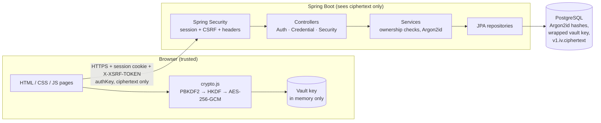
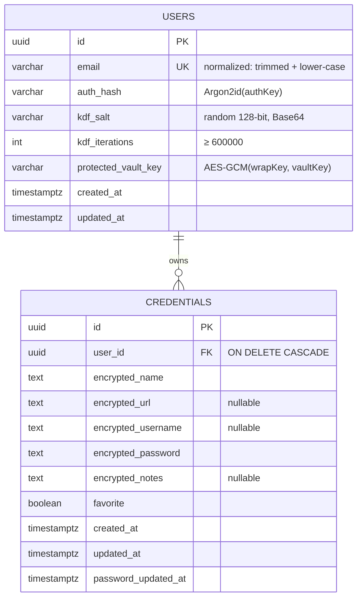
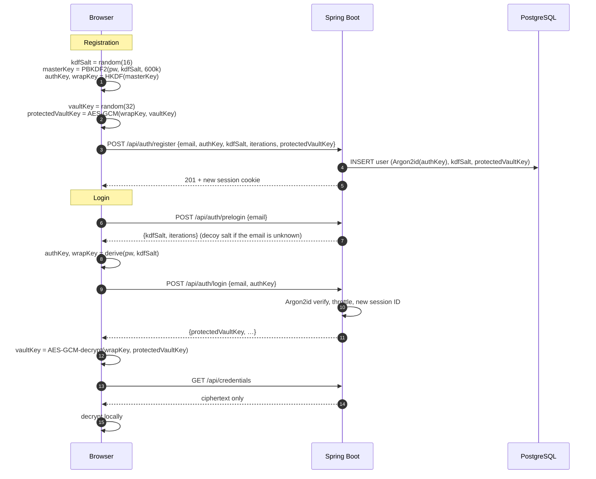

# VAULT 2.0

A browser-based password manager with **client-side vault encryption**. It has a Spring Boot backend and PostgreSQL storage, and the frontend is plain HTML, CSS and JavaScript with no framework.

VAULT 2.0 succeeds the VAULT desktop application (Java Swing + SQLite). The desktop app's cryptographic building blocks (PBKDF2-HMAC-SHA256 at 600,000 iterations, AES-256-GCM with a random 96-bit IV, separate salts for authentication and encryption) were kept. The architecture around them changed: on the web the server is a separate, potentially untrusted party, so encryption moved into the browser. See [Encryption and authentication design](#7-encryption-and-authentication-design).

> This is a student project. It has not been independently audited and should not be used to protect real secrets.

---

## Contents

1. [Project overview](#1-project-overview)
2. [Features](#2-features)
3. [Technology stack](#3-technology-stack)
4. [Architecture](#4-architecture)
5. [Directory structure](#5-directory-structure)
6. [Database design](#6-database-design)
7. [Encryption and authentication design](#7-encryption-and-authentication-design)
8. [Prerequisites](#8-prerequisites)
9. [Environment configuration](#9-environment-configuration)
10. [Database setup](#10-database-setup)
11. [Running the application](#11-running-the-application)
12. [Running the tests](#12-running-the-tests)
13. [API documentation](#13-api-documentation)
14. [Security considerations](#14-security-considerations)
15. [Known limitations](#15-known-limitations)
16. [Future enhancements](#16-future-enhancements)

---

## 1. Project overview

VAULT stores website logins: service name, URL, username, password and notes. **Every one of these fields is encrypted in the browser with AES-256-GCM before it is uploaded.** The Spring Boot server authenticates users, enforces ownership and stores ciphertext. During normal operation it never receives the master password, the vault encryption key or any plaintext credential.

## 2. Features

| Area | What is implemented |
|---|---|
| Accounts | Registration, login, logout, change master password, generic login errors, login throttling |
| Vault | Create, view, edit and delete credentials; favorites; notes; open website (http/https only) |
| Finding things | Instant search across name, URL and username; filters (all, favorites, needs attention, with website); five sort orders; grid and table layouts |
| Password tools | Web Crypto password generator (length 8–64 in the UI, 8–128 in the module; four character classes; no modulo bias; at least one character from each selected class); live strength meter |
| Security overview | Weak passwords and exact-reuse detection (computed in the browser), passwords unchanged for 180+ days (server metadata), vault health score. Breach monitoring is shown as **not available**. |
| Session safety | Vault locks on reload and after 15 minutes of inactivity; 30-minute server session timeout; "sign out other sessions"; other sessions signed out automatically when the master password changes |
| Clipboard | Copied passwords are cleared from the clipboard after 30 seconds (with limits, see §15) |
| UX | Responsive (desktop, tablet, phone), keyboard accessible (focus-trapped dialogs, `/` to search, Escape to close), loading skeletons, empty states, toasts, confirmation before deletion |

## 3. Technology stack

| Layer | Technology |
|---|---|
| Frontend | HTML5, CSS3 (custom design system with CSS variables), vanilla JavaScript ES modules, Fetch API, Web Crypto API, self-hosted Lucide icons (ISC) |
| Backend | Java 17, Spring Boot 3.5.16 (Web, Data JPA, Security, Validation), Hibernate 6 |
| Database | PostgreSQL (tested on 14; 16 in `docker-compose.yml`), Flyway migrations |
| Password hashing | Argon2id via Spring Security `Argon2PasswordEncoder` (Bouncy Castle 1.85) |
| Build and tests | Maven, JUnit 5, Spring MockMvc, spring-security-test, Node's built-in test runner for the browser modules |

## 4. Architecture



**Layers**

- `controller/` contains thin REST controllers. The user ID always comes from the authenticated principal and never from the request body or URL.
- `service/` holds the business logic and transactions. Every credential query is scoped with `findByIdAndOwnerId`.
- `repository/` holds Spring Data JPA repositories, so all queries are parameterized.
- `dto/` contains request and response records with Bean Validation. Entities are never serialized directly.
- `security/` contains the Spring Security configuration, user lookup, JSON 401/403 handlers and login throttling.
- `crypto/` holds the ciphertext format rules and the decoy-salt generator. The server does no vault encryption.
- `exception/` has the global handler, which returns a consistent `ApiError` and never includes stack traces, SQL or submitted values.

**Page flow:** `login.html` and `register.html` derive keys and authenticate. They then load `dashboard.html` *in the same document* (fetch, swap the body, `history.replaceState`), so the in-memory vault key survives the transition. A real reload of `dashboard.html` drops the key and shows the lock screen.

## 5. Directory structure

```
fcc_project/
├── pom.xml                         Maven build (Spring Boot 3.5.16, Java 17)
├── package.json                    Node test runner config for the browser modules
├── docker-compose.yml              Optional local PostgreSQL
├── .env.example                    Configuration template (placeholders only)
├── scripts/
│   ├── setup-local-db.sh           Creates role, databases and .env on a local PostgreSQL
│   └── create-test-db.sql          Used by docker-compose
└── src/
    ├── main/java/com/vault/
    │   ├── VaultApplication.java
    │   ├── config/VaultProperties.java
    │   ├── controller/             AuthController, CredentialController, SecurityController
    │   ├── crypto/                 CryptoFormats, PreloginSaltGenerator
    │   ├── dto/                    Request/response records
    │   ├── exception/              ApiException, GlobalExceptionHandler, …
    │   ├── model/                  User, Credential (JPA entities)
    │   ├── repository/             UserRepository, CredentialRepository
    │   ├── security/               SecurityConfig, LoginAttemptService, principal, handlers
    │   └── service/                AuthService, CredentialService, SessionService, SecurityOverviewService
    ├── main/resources/
    │   ├── application.yml
    │   ├── db/migration/V1__initial_schema.sql
    │   └── static/
    │       ├── index.html  register.html  login.html  dashboard.html
    │       ├── css/        base.css (design tokens + components), landing.css, auth.css, app.css
    │       ├── js/         api.js, auth.js, crypto.js, dashboard.js, password-generator.js, strength.js, ui.js
    │       └── assets/icons.svg
    └── test/
        ├── java/com/vault/         Integration and unit tests, TestVaultClient (Java mirror of crypto.js)
        ├── js/                     Node tests for crypto.js, password-generator.js, strength.js
        └── resources/              application-test.yml, crypto-vectors.json
```

## 6. Database design



- The schema is created by **Flyway** (`V1__initial_schema.sql`). Hibernate runs with `ddl-auto: validate` and never alters it.
- Indexes: a unique index on `users.email`, `(user_id, updated_at DESC)` for listing, and a partial index on favorites.
- Check constraints keep emails normalized and refuse KDF iteration counts below 600,000.
- `password_updated_at` changes only when the client reports that the password itself changed. This is what makes the "not changed in 180+ days" check meaningful.

## 7. Encryption and authentication design

### Password hashing vs encryption

- **Hashing** is one-way. You can check whether an input matches, but you cannot recover the input. It is the right tool for *verifying* a secret. VAULT hashes the authentication key with **Argon2id**, which is deliberately slow and memory-hard so that offline guessing is expensive.
- **Encryption** is two-way with a key. It is the right tool for data you need to *read back*, such as saved website passwords. VAULT encrypts with **AES-256-GCM**, which also *authenticates* the data: any modification is detected on decryption.
- Base64 is neither. It is only an encoding and is used here to put bytes into JSON.

### Conventional encrypted vault vs zero-knowledge vault

| | Conventional encrypted vault | Zero-knowledge (client-side) vault |
|---|---|---|
| Where encryption happens | On the server | In the user's browser |
| What the server receives | Master password and plaintext secrets (encrypted before storage) | A derived authentication key and ciphertext only |
| Database theft alone | Exposes ciphertext. Exposes plaintext if the server's key is also taken. | Exposes ciphertext, which is protected by the user's master password via PBKDF2 |
| Compromised running server | Can read everything that passes through it | Cannot read stored data directly, but **could serve malicious JavaScript** that steals the master password at the next login |
| Account recovery | Possible | Impossible without the master password |

The desktop VAULT is effectively the "conventional" design run locally: one process derives the key and encrypts. **VAULT 2.0 implements the client-side design.** This repository calls it *client-side encryption* rather than an unqualified "zero knowledge" claim, because the server still learns metadata (§14) and delivers the code that does the encryption.

### Key hierarchy

```
master password (never leaves the browser)
   │  NFC-normalized, UTF-8
   ▼
PBKDF2-HMAC-SHA256(password, kdfSalt[16 random bytes], 600,000 iterations) → masterKey (256 bit)
   │
   ├── HKDF-SHA256(masterKey, info="vault-auth-v1") → authKey (256 bit) ──► sent to server ──► Argon2id ──► users.auth_hash
   │
   └── HKDF-SHA256(masterKey, info="vault-wrap-v1") → wrapKey (256 bit, non-extractable CryptoKey)
                                                              │
               vaultKey (256 bit, random, generated once) ◄── AES-256-GCM unwrap of users.protected_vault_key
                     │
                     └── AES-256-GCM encrypts every credential field
```

- **Separate derivations.** HKDF with different `info` labels produces independent keys. Knowing `authKey` (which the server sees briefly) does not reveal `wrapKey`. This extends the desktop app's "two salts" idea.
- **Why PBKDF2 in the browser?** Web Crypto has no Argon2. PBKDF2-HMAC-SHA256 at 600,000 iterations matches the desktop app and current OWASP guidance. The server rejects fewer than 600,000 iterations.
- **Why a random vault key?** Changing the master password only re-wraps one 32-byte key. No credentials need re-encrypting, so the operation is atomic.
- **Why Argon2id on top of PBKDF2?** If the database leaks, an attacker cannot simply replay the stored value to log in. Guessing master passwords offline also has to pay for both PBKDF2 and Argon2id.

### Ciphertext format

```
v1.<Base64(12-byte IV)>.<Base64(ciphertext ‖ 16-byte GCM tag)>
```

- A **fresh random 96-bit IV** comes from `crypto.getRandomValues` for every encryption. It is never constant and never reused.
- **Associated data** is `vault:v1:<field>` (`name`, `url`, `username`, `password`, `notes`, or `vault-key`), so a ciphertext cannot be moved into a different field.
- The server validates the *shape* of every value (`CryptoFormats.java`) and rejects plaintext, but it cannot decrypt anything.
- `src/test/resources/crypto-vectors.json` is produced by running the real `crypto.js` under Node. `BrowserCompatibilityTest` proves that an independent Java implementation derives the same `authKey` and decrypts the same ciphertexts.

### Registration and login



### Sessions and CSRF

- Spring Security uses a server-side **HttpSession**. The `VAULT_SESSION` cookie is `HttpOnly`, `SameSite=Strict`, and `Secure` when `COOKIE_SECURE=true`. A login always creates a fresh session ID (session fixation protection).
- **CSRF** uses the double-submit cookie pattern. The `XSRF-TOKEN` cookie (`SameSite=Strict`, readable by JS) must be echoed in the `X-XSRF-TOKEN` header on every `POST/PUT/PATCH/DELETE`, including login, which prevents login-CSRF. `api.js` handles this automatically.
- No session ID, token, key or master password is ever written to `localStorage` or `sessionStorage`. The only thing in `localStorage` is the grid/table layout preference.

## 8. Prerequisites

- JDK 17 or newer
- Maven 3.8+
- PostgreSQL 14+ (local install or Docker)
- Node.js 20+ (only to run the JavaScript unit tests)
- A modern browser with Web Crypto support (current Chrome, Edge, Firefox or Safari). Web Crypto works only in a **secure context**: `https://` or `http://localhost`.

## 9. Environment configuration

Configuration comes from environment variables. For convenience, Spring Boot also reads a git-ignored `.env` file in the project root (`spring.config.import: optional:file:.env[.properties]`).

```bash
cp .env.example .env    # then edit the values
```

| Variable | Purpose | Default |
|---|---|---|
| `DB_URL`, `DB_USERNAME`, `DB_PASSWORD` | Application database | `jdbc:postgresql://localhost:5432/vault`, `vault_app`, empty |
| `TEST_DB_URL` (+ optional `TEST_DB_USERNAME`, `TEST_DB_PASSWORD`) | Database used by integration tests. **It is wiped by the tests.** | `jdbc:postgresql://localhost:5432/vault_test` |
| `VAULT_PRELOGIN_SECRET` | Key for decoy salts. Set a long random value. | Random per process (with a warning) |
| `PORT` | HTTP port | `8787` |
| `COOKIE_SECURE` | `Secure` flag on cookies. Must be `true` in production. | `true` |
| `SESSION_TIMEOUT` | Server session idle timeout | `30m` |
| `SSL_ENABLED`, `SSL_KEY_STORE`, `SSL_KEY_STORE_PASSWORD`, `SSL_KEY_STORE_TYPE` | Built-in HTTPS | disabled |
| `FORWARD_HEADERS_STRATEGY` | `native` only behind a trusted reverse proxy | `none` |

## 10. Database setup

**Option A: local PostgreSQL (e.g. Homebrew)**

```bash
./scripts/setup-local-db.sh        # creates role vault_app, databases vault + vault_test, and .env
```

Or by hand:

```sql
CREATE ROLE vault_app LOGIN PASSWORD 'choose-a-strong-password';
CREATE DATABASE vault OWNER vault_app;
CREATE DATABASE vault_test OWNER vault_app;
```

**Option B: Docker**

```bash
cp .env.example .env               # set DB_PASSWORD
docker compose up -d
```

Tables are created automatically by Flyway the first time the application starts.

## 11. Running the application

```bash
mvn spring-boot:run
# open http://localhost:8787
```

Or build a standalone jar:

```bash
mvn clean package
java -jar target/vault-web-2.0.0.jar
```

**Local HTTPS (optional)**

```bash
keytool -genkeypair -alias vault -keyalg EC -groupname secp256r1 -validity 365 \
  -storetype PKCS12 -keystore vault-dev.p12 -dname "CN=localhost"
SSL_ENABLED=true SSL_KEY_STORE=file:vault-dev.p12 SSL_KEY_STORE_PASSWORD=… COOKIE_SECURE=true mvn spring-boot:run
# https://localhost:8787  (self-signed: the browser will warn)
```

In production, terminate TLS at the app or at a reverse proxy, keep `COOKIE_SECURE=true`, and set `FORWARD_HEADERS_STRATEGY=native` only if the proxy is trusted. HSTS is sent automatically on HTTPS responses.

### Deploying to Render

The repository includes a `Dockerfile` and a `render.yaml` Blueprint that creates a free PostgreSQL database and one web service.

1. Push this repository to GitHub.
2. On [render.com](https://render.com), choose **New → Blueprint**, connect GitHub, and select the repository.
3. Confirm the resources (`vault-db` and `vault`). Render builds the image, injects the database settings, generates `VAULT_PRELOGIN_SECRET`, and serves the app at `https://vault-xxxx.onrender.com` with HTTPS.

Notes on the free plan:

- The app sleeps after about 15 minutes without traffic, so the next visit takes 30–60 seconds. Waking from sleep is a restart, so users are signed out; saved data is kept.
- Free PostgreSQL databases expire after 30 days unless upgraded.
- Keep `numInstances: 1`, because sessions and login throttling are stored in memory.
- `FORWARD_HEADERS_STRATEGY=native` is required behind Render's proxy. Without it, every visitor would share the proxy's IP for login throttling, and the app could not tell that requests arrived over HTTPS.

## 12. Running the tests

The integration tests need the `vault_test` database (see §10). They delete all rows in it before each test.

```bash
mvn test        # 47 Java tests: unit + integration (MockMvc against real PostgreSQL)
npm test        # 22 JavaScript tests for crypto.js, password-generator.js and strength.js (Node 20+, no npm install needed)
```

| Test class | Covers |
|---|---|
| `AuthIntegrationTest` | Registration, email normalization, duplicate rejection, validation, malformed JSON, successful and failed login with identical errors, decoy prelogin salts, throttling (429), 401 on protected endpoints, CSRF enforcement, logout, master-password change (other sessions expired, old key rejected), session info, security headers |
| `CredentialIntegrationTest` | Create, list, get, update (password-age tracking), favorite toggle, delete, **cross-user read/update/favorite/delete prevention**, rejection of plaintext and oversized values, security overview scoping |
| `ZeroKnowledgeFlowTest` | Full browser-equivalent flow with real PBKDF2/HKDF/AES-GCM; asserts that no plaintext, master password or authKey is in the database; DB-level ciphertext tampering is detected |
| `BrowserCompatibilityTest` | Java and `crypto.js` agree byte-for-byte; tampering and field-swapping fail; fresh IVs |
| `CsrfFlowTest` | The real cookie-to-header CSRF flow used by `api.js` |
| `CryptoFormatsTest`, `PreloginSaltGeneratorTest`, `LoginAttemptServiceTest` | Unit tests |
| `src/test/js/*.test.mjs` | Encryption round-trips, NFC handling, IV uniqueness, tamper/AAD rejection, re-wrapping, generator constraints and uniform randomness, strength heuristic |

To regenerate the cross-language vector after changing `crypto.js`: `npm run vectors`.

## 13. API documentation

All endpoints are JSON under `/api`. All `POST`, `PUT`, `PATCH` and `DELETE` requests need the `X-XSRF-TOKEN` header that matches the `XSRF-TOKEN` cookie. Authenticated endpoints need the `VAULT_SESSION` cookie. All example values below are fictional.

**Error format** (every error, including 401/403 from the security layer):

```json
{
  "status": 400,
  "error": "Bad Request",
  "message": "Some fields are invalid.",
  "fieldErrors": [{ "field": "email", "message": "must be a well-formed email address" }],
  "timestamp": "2026-10-23T08:15:30Z"
}
```

Submitted values are never echoed back.

### Authentication

| Method | Path | Auth | Description |
|---|---|---|---|
| GET | `/api/auth/csrf` | – | Issues the CSRF cookie and returns `{ "headerName": "X-XSRF-TOKEN", "token": "…" }` |
| POST | `/api/auth/prelogin` | – | Returns KDF parameters for an email (decoy values if the email is unknown) |
| POST | `/api/auth/register` | – | Creates an account and signs in. `201` |
| POST | `/api/auth/login` | – | Signs in. `200`, or `401` (generic) or `429` (throttled) |
| POST | `/api/auth/logout` | ✓ | Ends the session. `204` |
| GET | `/api/auth/me` | ✓ | Current account, KDF parameters and wrapped vault key |
| GET | `/api/auth/session` | ✓ | Session timestamps, timeout, active session count |
| POST | `/api/auth/sessions/revoke-others` | ✓ | Expires the user's other sessions |
| POST | `/api/auth/change-password` | ✓ | Rotates the auth hash, salt and wrapped vault key; expires other sessions |

`POST /api/auth/prelogin`

```json
// request
{ "email": "alex@example.com" }
// 200
{ "kdfAlgorithm": "PBKDF2-HMAC-SHA256", "kdfSalt": "q1w2E3r4T5y6U7i8O9p0Aw==", "kdfIterations": 600000 }
```

`POST /api/auth/register`

```json
// request — every value except email was produced in the browser
{
  "email": "alex@example.com",
  "authHash": "3q2+7wABAgMEBQYHCAkKCwwNDg8QERITFBUWFxgZGhs=",
  "kdfSalt": "q1w2E3r4T5y6U7i8O9p0Aw==",
  "kdfIterations": 600000,
  "protectedVaultKey": "v1.AAECAwQFBgcICQoL.ZmljdGlvbmFsIHdyYXBwZWQgdmF1bHQga2V5IGZvciBkb2N1bWVudGF0aW9uISEh"
}
// 201 (also returned by /login and /me)
{
  "id": "6f1c2b0e-8d4a-4b8e-9a51-0c2f6a7d3e11",
  "email": "alex@example.com",
  "createdAt": "2026-10-23T08:15:30Z",
  "updatedAt": "2026-10-23T08:15:30Z",
  "kdfAlgorithm": "PBKDF2-HMAC-SHA256",
  "kdfSalt": "q1w2E3r4T5y6U7i8O9p0Aw==",
  "kdfIterations": 600000,
  "protectedVaultKey": "v1.AAECAwQFBgcICQoL.ZmljdGlvbmFsIHdyYXBwZWQgdmF1bHQga2V5IGZvciBkb2N1bWVudGF0aW9uISEh"
}
// 409 if the email is taken; 400 on validation errors or iterations < 600000
```

`POST /api/auth/login`

```json
{ "email": "alex@example.com", "authHash": "3q2+7wABAgMEBQYHCAkKCwwNDg8QERITFBUWFxgZGhs=" }
// 401
{ "status": 401, "error": "Unauthorized", "message": "Invalid email or master password.", "timestamp": "…" }
```

`POST /api/auth/change-password`

```json
{
  "currentAuthHash": "3q2+7wABAgMEBQYHCAkKCwwNDg8QERITFBUWFxgZGhs=",
  "newAuthHash": "AAECAwQFBgcICQoLDA0ODxAREhMUFRYXGBkaGxwdHh8=",
  "newKdfSalt": "Zx9Yw8Xv7Ut6Sr5Qp4On3A==",
  "newKdfIterations": 600000,
  "newProtectedVaultKey": "v1.CwoJCAcGBQQDAgEA.YW5vdGhlciBmaWN0aW9uYWwgd3JhcHBlZCBrZXksIGRvY3MgZXhhbXBsZSBvbmx5"
}
// 200 → updated user; 400 if the current key is wrong
```

`GET /api/auth/session`

```json
{ "createdAt": "2026-10-23T08:15:30Z", "lastAccessedAt": "2026-10-23T08:20:02Z", "maxInactiveSeconds": 1800, "activeSessions": 2 }
```

### Credentials

| Method | Path | Description |
|---|---|---|
| GET | `/api/credentials` | All of the user's credentials, newest first |
| GET | `/api/credentials/{id}` | One credential (`404` if missing **or owned by someone else**) |
| POST | `/api/credentials` | Create. `201` with `Location` header |
| PUT | `/api/credentials/{id}` | Replace all fields |
| PATCH | `/api/credentials/{id}/favorite` | `{ "favorite": true }` |
| DELETE | `/api/credentials/{id}` | `204` |

There is no pagination. The browser needs the whole vault to search and analyse decrypted data locally, so each account is capped at 5,000 credentials instead.

Request body (`POST` and `PUT`). Every `encrypted*` value must match `v1.<16 Base64 chars>.<Base64 ≥ 24 chars>`:

```json
{
  "encryptedName": "v1.Ab12Cd34Ef56Gh78.ZmljdGlvbmFsLWNpcGhlcnRleHQtbmFtZQ==",
  "encryptedUrl": "v1.Ij90Kl12Mn34Op56.ZmljdGlvbmFsLWNpcGhlcnRleHQtdXJsLXZhbHVl",
  "encryptedUsername": "v1.Qr78St90Uv12Wx34.ZmljdGlvbmFsLWNpcGhlcnRleHQtdXNlcg==",
  "encryptedPassword": "v1.Yz56Ab78Cd90Ef12.ZmljdGlvbmFsLWNpcGhlcnRleHQtcGFzc3dvcmQ=",
  "encryptedNotes": null,
  "favorite": false,
  "passwordChanged": true
}
```

`passwordChanged` is ignored on create. On update it tells the server whether to refresh `passwordUpdatedAt`, because the server cannot compare the encrypted passwords itself.

Response:

```json
{
  "id": "0b9d6a4e-2f7c-4d1e-8c3a-5e6f7a8b9c0d",
  "encryptedName": "v1.Ab12Cd34Ef56Gh78.ZmljdGlvbmFsLWNpcGhlcnRleHQtbmFtZQ==",
  "encryptedUrl": "v1.Ij90Kl12Mn34Op56.ZmljdGlvbmFsLWNpcGhlcnRleHQtdXJsLXZhbHVl",
  "encryptedUsername": "v1.Qr78St90Uv12Wx34.ZmljdGlvbmFsLWNpcGhlcnRleHQtdXNlcg==",
  "encryptedPassword": "v1.Yz56Ab78Cd90Ef12.ZmljdGlvbmFsLWNpcGhlcnRleHQtcGFzc3dvcmQ=",
  "encryptedNotes": null,
  "favorite": false,
  "createdAt": "2026-10-23T08:16:00Z",
  "updatedAt": "2026-10-23T08:16:00Z",
  "passwordUpdatedAt": "2026-10-23T08:16:00Z"
}
```

### Security overview

`GET /api/security/overview` returns only what the server can know without decrypting:

```json
{
  "totalCredentials": 12,
  "favoriteCredentials": 3,
  "stalePasswords": 2,
  "staleAfterDays": 180,
  "oldestPasswordUpdate": "2025-11-02T10:00:00Z",
  "lastVaultUpdate": "2026-10-23T08:16:00Z",
  "kdfAlgorithm": "PBKDF2-HMAC-SHA256",
  "kdfIterations": 600000,
  "breachMonitoringAvailable": false
}
```

The browser computes weak and reused counts after decrypting, and they are never sent to the server.

## 14. Security considerations

**What the server and database can see:** email address; account creation and update times; number of credentials; each credential's created, updated and password-changed timestamps and favorite flag; the **approximate length** of each encrypted field (AES-GCM does not hide length); and IP addresses in memory for throttling.

**What they cannot see:** the master password, the vault key, and any service name, URL, username, password or note.

**Implemented safeguards**

- Argon2id hashing of a PBKDF2/HKDF-derived key. The server never stores or receives a reversible form of the master password.
- AES-256-GCM with random IVs and field-binding associated data. Integrity failures surface as "Unreadable" items rather than silently wrong data.
- Ownership enforced in every repository query. Other users' records return `404`, not `403`, so their existence isn't confirmed.
- Generic login errors, decoy prelogin salts, and Spring's dummy password check for unknown users, all to reduce account enumeration.
- Login throttling: 10 failures per account or 30 per IP within 15 minutes leads to `429`. Wrong current passwords in change-password count too.
- Session fixation protection, `HttpOnly` / `SameSite=Strict` / `Secure` cookies, and CSRF on all state-changing requests including login.
- Strict **Content-Security-Policy** (`script-src 'self'`, no inline scripts, no third-party origins), `X-Frame-Options: DENY`, `Referrer-Policy: no-referrer`, `nosniff`, `Permissions-Policy`, `Cross-Origin-Opener-Policy`, and HSTS over HTTPS.
- All user data is rendered with `textContent` (no `innerHTML`). Website links are restricted to `http:`/`https:` and opened with `noopener,noreferrer`.
- No secrets in logs. DTO `toString()` methods redact key material, and the exception handler logs only exception types.
- Bean Validation on every request. Plaintext submitted where ciphertext is expected is rejected.

**The frontend delivery path matters.** Client-side encryption protects data *at rest on the server*. It cannot protect against a compromised server, a tampered deployment, or a malicious browser extension that alters `crypto.js` or reads the page. Mitigations here are self-hosted assets, a strict CSP and HTTPS. Stronger guarantees would need a signed browser extension or a native client.

**Browser extensions and password managers** run with access to page content. A malicious or over-privileged extension can read decrypted values that are shown on screen.

## 15. Known limitations

- **Master password strength is enforced only in the browser.** The server never sees the password, so a modified client could register with a weak one.
- **No account recovery.** If the master password is lost, the vault is unrecoverable by design.
- **Registration reveals whether an email is registered** (`409`). Login and prelogin do not, but preventing enumeration at sign-up would need an email-verification flow, which is not implemented.
- **Decoy salts change on restart** if `VAULT_PRELOGIN_SECRET` is not set. That would let someone distinguish unknown emails across restarts.
- **In-memory server state.** Sessions and login-throttle counters live in memory, so a restart signs everyone out and the design assumes a single server instance. Spring Session JDBC and a shared rate limiter would be needed to scale out.
- **JavaScript strings cannot be wiped.** Keys are non-extractable `CryptoKey`s and byte arrays are zeroed, but decrypted strings remain in memory until garbage collected.
- **Clipboard clearing is best-effort.** Browsers allow clipboard writes only while the page is focused. Clipboard-history tools (Windows Win+V, macOS clipboard managers) may keep a copy. If you copy something else within 30 seconds, VAULT may clear that instead.
- **Field-level AAD does not bind a ciphertext to a specific record.** A malicious server could swap whole fields between two of the same user's records. It still cannot read them or move them to another user, whose key differs.
- **Weak-password detection is a heuristic**, not a cracking estimate. **Breach monitoring is not implemented** and is labelled as such in the UI.
- **Auto-lock** happens after 15 minutes without keyboard, pointer, wheel or touch activity, and on every reload.
- **No 2FA, email verification, account deletion, import/export, sharing or autofill.**
- **The desktop VAULT's SQLite data is not migrated.** Its server-side key model is incompatible with client-side encryption. A migration would have to decrypt locally with the desktop app and re-encrypt in the browser.

## 16. Future enhancements

- WebAuthn/passkeys or TOTP as a second factor
- Encrypted export and import, including an importer for the desktop VAULT
- Argon2id in the browser via a vetted WebAssembly build
- Record-ID binding in associated data
- Spring Session JDBC and a distributed rate limiter for multi-instance deployments
- Privacy-preserving breach checks using the k-anonymity range API pattern, with explicit user consent
- Account deletion and data-retention controls
- A browser extension for autofill, which would also pin the client code
- Secure sharing using per-user public keys
